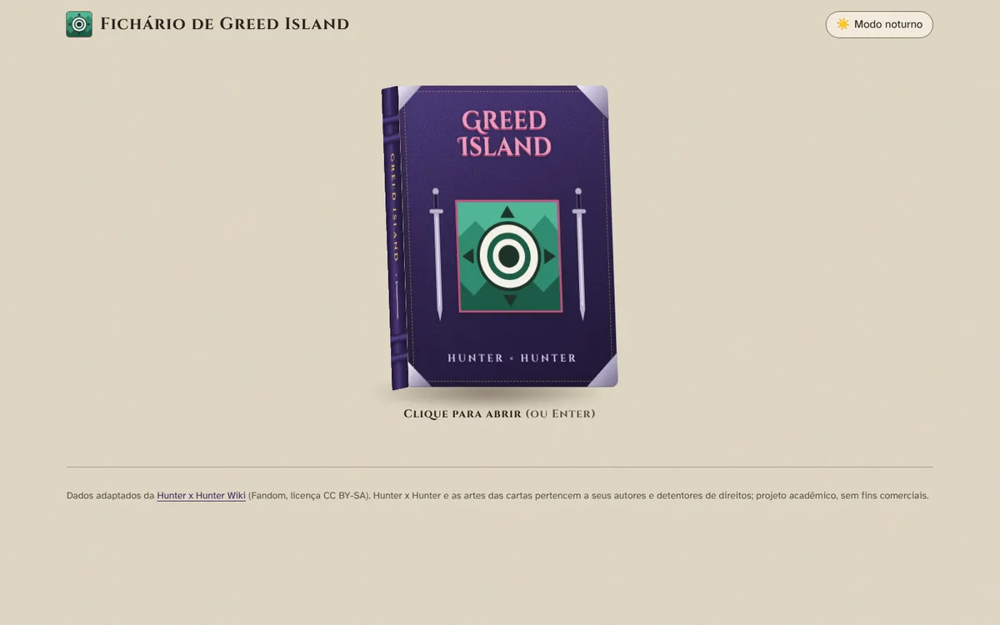
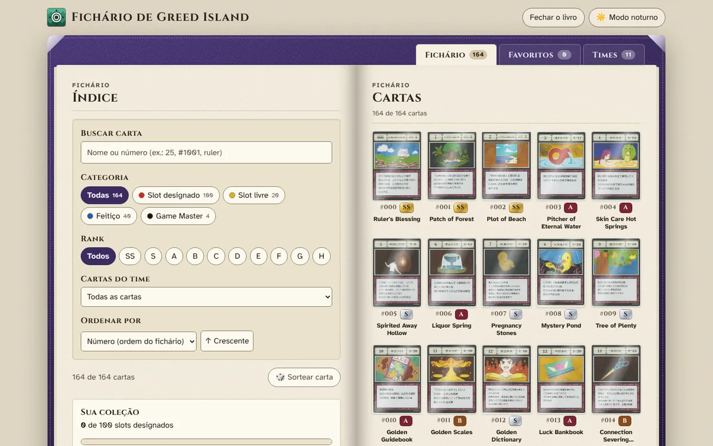
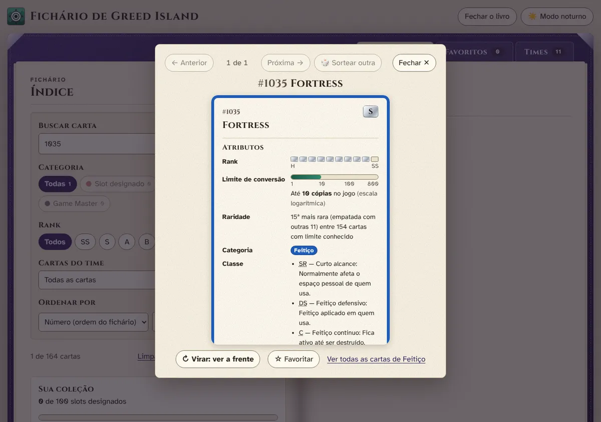
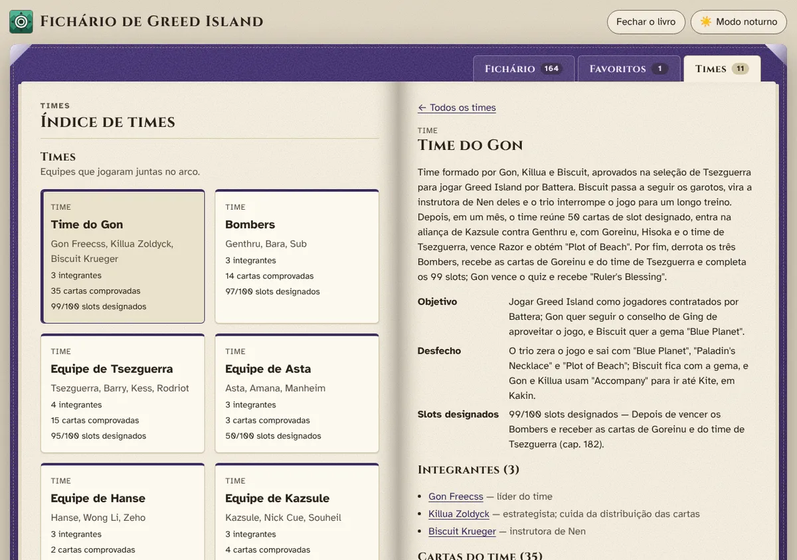
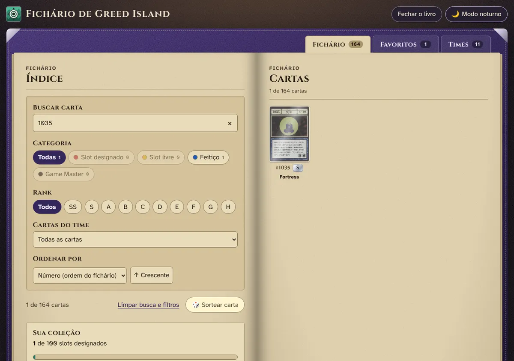
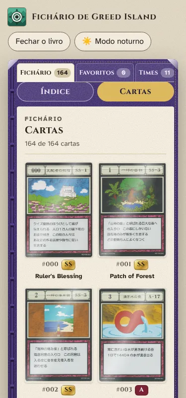

# Fichário de Greed Island

Um "fichário" interativo das cartas de **Greed Island**, o jogo do arco homônimo de *Hunter x Hunter*. É uma adaptação da Atividade 03 (Pokédex) feita em **React + Vite**.

O livro abre em 3D. Dentro dele, um índice de busca e filtros fica de frente para páginas de bolsos plásticos. Cada carta pode ser ampliada e virada para ler os atributos no verso. A aba **Times** mostra os grupos que disputaram o jogo e as cartas que cada um teve, sempre com o trecho da wiki que prova a informação.

| Livro fechado | Fichário aberto |
|---|---|
|  |  |
| **Carta ampliada (verso)** | **Times** |
|  |  |
| **Modo noturno (luz de lampião)** | **Celular** |
|  |  |

## Como rodar

Requisitos: **Node.js 20 ou mais recente**.

```bash
npm install
```

```bash
npm run dev
```

Depois, abra **http://localhost:5173**.

| Comando | O que faz |
|---|---|
| `npm run dev` | servidor de desenvolvimento |
| `npm run build` | gera a versão de produção em `dist/` |
| `npm run preview` | serve o `dist/` localmente |
| `npm test` | testes unitários (executor nativo do Node, sem dependência extra) |
| `npm run lint` | análise estática (oxlint) |
| `npm run data` | regenera `src/data/greed-island-cards.json` a partir do CSV |

## Onde ficam os dados e as imagens

- **Cartas:** `scripts/greed-island-cards.csv` → convertido por `scripts/csv-to-json.mjs` em `src/data/greed-island-cards.json`, com 164 cartas.
- **Times e jogadores:** `src/data/teams.json` e `src/data/players.json`. Cada carta atribuída a um time ou jogador traz o trecho da wiki e o capítulo do mangá como prova. O método está em [`docs/pesquisa-times.md`](docs/pesquisa-times.md).
- **Imagens:** `src/assets/cards/<id>.webp` (ex.: `000.webp`, `-001.webp`), carregadas com `import.meta.glob` do Vite. Se uma arte faltar ou não carregar, o app usa `src/assets/ui/sem-imagem.svg`.

## Organização das pastas

```text
src/
├── App.jsx                  # compõe os hooks e decide: livro fechado ou aberto
├── components/
│   ├── book/                # Book, BookCover (3D), BookSpine, BookSpread, BookPage, PageSwitch, Emblem, Sword
│   ├── cards/               # CardSlot (bolso), CardGrid, PocketPage, CardDetails (modal), CardBack,
│   │                        #   CardImage, RankBadge, RankMeter, LimitMeter, CategoryBadge, CollectionProgress
│   ├── controls/            # Tabs, SearchBar, FilterChips, CategoryFilter, RankFilter, TeamFilter, SortControl, ThemeToggle
│   ├── teams/               # TeamList, TeamCard, TeamPage, MemberPage
│   ├── feedback/            # EmptyState
│   └── views/               # BinderView, FavoritesView, TeamsView (montam cada aba)
├── domain/                  # regras puras, sem React, com testes (*.test.js)
│   ├── catalog.js           #   único lugar que lê os JSON
│   ├── cards.js             #   normalização, busca, filtros, ordenação, raridade, sorteio
│   ├── teams.js · routes.js · book.js · pagination.js · meters.js · format.js · color.js · palette.js
├── hooks/                   # useCardFilters, useFavorites, useTheme, useHashRoute, useCardDetail,
│                            #   useBookState, usePagination, useMediaQuery, useDialog
├── css/                     # um arquivo por componente
├── data/                    # JSON das cartas, times e jogadores
└── index.css                # design system: tokens de materiais, contextos de superfície, modo noturno
```

## Conceitos de React e onde eles aparecem

| Conceito | Onde |
|---|---|
| Componentes funcionais e props | todos os arquivos de `src/components`; os componentes de apresentação recebem tudo por props |
| Componente reutilizável | `FilterChips` (base de `CategoryFilter` e `RankFilter`), `CardGrid` (fichário, favoritos e times), `EmptyState` |
| `useState` | filtros (`useCardFilters`), favoritos (`useFavorites`), carta virada (`CardDetails`), página no celular (`BinderView`) |
| `useEffect` (com limpeza) | salvar no `localStorage`, ouvir o `hashchange` e o evento `storage`, título da aba, timer da animação do livro, devolver o foco |
| `useMemo` / estado derivado | cartas visíveis e contagens (`useCardFilters`), coleção dos favoritos (`App`) |
| `useCallback` | funções passadas por props e usadas como dependência de efeito (`navigate`, `toggleFavorite`, `openCardFrom`) |
| `useReducer` (máquina de estados) | `useBookState` + `bookReducer` (fechado → abrindo → aberto → fechando) |
| `useRef` | foco nas abas (`Tabs`), devolução do foco ao fechar o modal e o livro |
| `useId` | ligação `<label>` ↔ campo em `SearchBar`, `TeamFilter`, `SortControl` |
| `useSyncExternalStore` | `useMediaQuery` (tema do sistema, movimento reduzido) |
| Hooks customizados | toda a pasta `src/hooks` |
| `map()` com `key` estável | `CardGrid` (`key={card.id}`), listas de times e integrantes |
| `key` para reiniciar estado/animação | `PocketPage` (virar a página), `CardImage` (imagem reserva) |
| Eventos | busca controlada, Esc, setas, clique fora do modal, teclado nas abas |
| Filtragem | `filterCards` / `searchCards` (`src/domain/cards.js`) |
| Renderização condicional | `TeamsView` (lista, time, integrante, "não encontrado"), `EmptyState`, `BookCover` × `Book` |
| `createPortal` | `CardDetails` (modal no `<body>`, fundo `inert`) |
| `React.memo` | `CardSlot` |

## Acessibilidade

- Contraste WCAG AA verificado por uma auditoria automática de cada texto visível, nas 11 telas principais e nos dois temas.
- Navegação completa por teclado:
  - o livro abre e fecha;
  - as abas respondem a setas, Home e End;
  - a carta abre, vira, navega, é favoritada e fecha só com teclas.
- O modal tem `role="dialog"`, `aria-modal`, fundo `inert` e armadilha de foco, e devolve o foco a quem o abriu.
- Também há `aria-live` nos contadores, `aria-pressed` nos filtros e `prefers-reduced-motion`, que troca as animações por fades.

## Deploy (GitHub Pages)

**Link:** https://pacheco-davi.github.io/greed-island-binder/

O workflow `.github/workflows/deploy.yml` roda os testes, gera o build e publica o site a cada push na `main`. Para ativar, uma vez só: *Settings → Pages → Source: **GitHub Actions***.

- O `base: '/greed-island-binder/'` no `vite.config.js` existe porque o site fica numa subpasta do domínio.
- A navegação usa hash (`#/times/gon`). Por isso, recarregar qualquer página funciona mesmo num servidor só de arquivos estáticos, sem erro 404.

## Créditos

- **Dados textuais** adaptados da [Hunter x Hunter Wiki](https://hunterxhunter.fandom.com/wiki/Greed_Island_Card_Lists) (Fandom), licença [CC BY-SA](https://creativecommons.org/licenses/by-sa/3.0/). Os resumos de times e jogadores foram escritos em português a partir das páginas da [categoria Greed Island Players](https://hunterxhunter.fandom.com/wiki/Category:Greed_Island_Players).
- ***Hunter x Hunter*, o livro de Greed Island e as artes das cartas** pertencem a Yoshihiro Togashi e aos demais detentores de direitos. Eles são usados aqui em um projeto acadêmico, sem fins comerciais.
- **Fontes:** Cinzel, Cinzel Decorative e Atkinson Hyperlegible, via Google Fonts.
